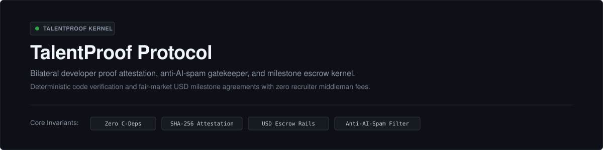
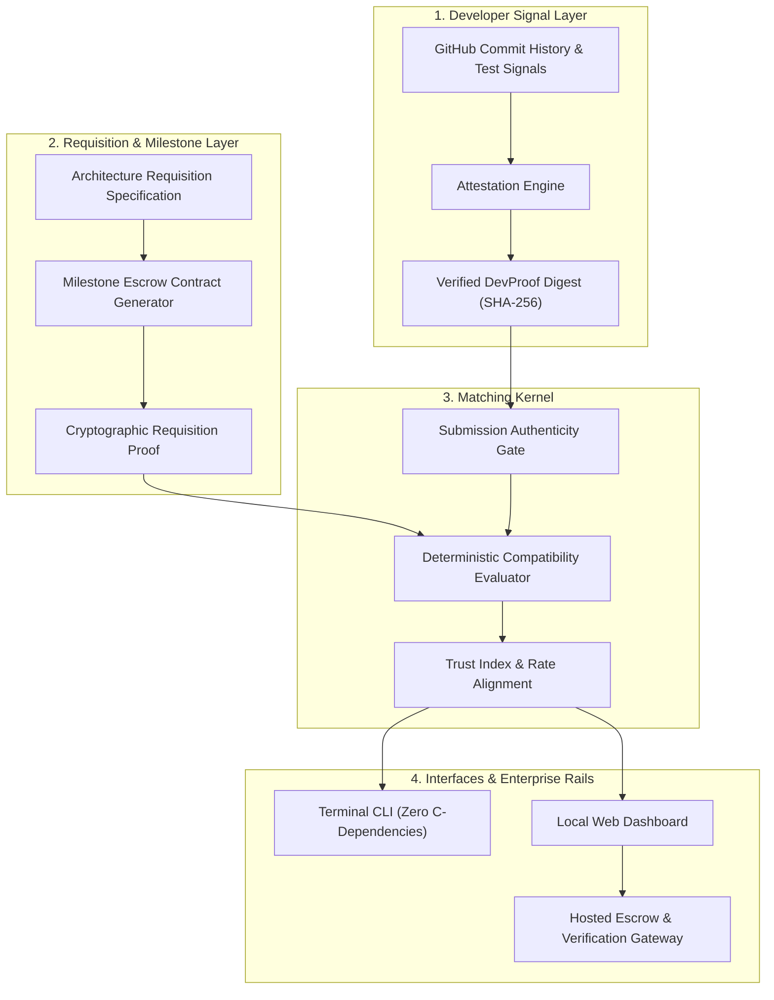

# TalentProof Protocol (`talentproof-protocol`)

<p align="center">
  
</p>

<p align="center">
  <a href="https://amz34.github.io/talentproof-protocol"></a>
  <a href="https://github.com/Amz34/talentproof-protocol/actions"></a>
  <a href="https://github.com/Amz34/talentproof-protocol/releases"></a>
  <a href="https://github.com/Amz34/talentproof-protocol/blob/main/LICENSE"></a>
  <a href="https://github.com/Amz34/talentproof-protocol/stargazers"></a>
</p>

---

## The Core Problem

The global tech recruiting and contractor ecosystem suffers from structural friction on both sides:

```
  ┌────────────────────────────────────────────────────────────────────────────────────────┐
  │                           BILATERAL MARKETPLACE FRICTION                               │
  ├───────────────────────────────────────────┬────────────────────────────────────────────┤
  │       FOR RECRUITERS & FOUNDERS           │         FOR DEVELOPERS & SEEKERS           │
  ├───────────────────────────────────────────┼────────────────────────────────────────────┤
  │ • High volume of automated AI resume spam │ • Silent rejections with zero feedback     │
  │ • Self-reported, unverifiable claims      │ • Unpaid take-home assignments             │
  │ • 20% to 30% agency placement margins     │ • Delayed milestone releases               │
  │ • Lack of deterministic technical signals │ • Platform lock-in and high platform fees  │
  └───────────────────────────────────────────┴────────────────────────────────────────────┘
```

**TalentProof Protocol** replaces resumes and intermediaries with deterministic code verification, bilateral technical matching, and test-locked milestone escrow agreements.

---

## System Architecture



---

## Quickstart

TalentProof requires only Python 3.10 or higher. No external services or compiled extensions required.

### 1. Installation & Simulation
```bash
git clone https://github.com/Amz34/talentproof-protocol.git
cd talentproof-protocol

# Run end-to-end interactive simulation
python3 -m talentproof.cli.main demo
```

### 2. Generate Developer Attestation
```bash
# Output JSON attestation
python3 -m talentproof.cli.main proof Amz34

# Generate SVG badge markup
python3 -m talentproof.cli.main proof Amz34 --svg > profile_badge.svg
```

### 3. Generate Milestone Escrow Agreement
```bash
python3 -m talentproof.cli.main contract \
  --client "Apex Enterprises" \
  --dev "Amz34" \
  --scope "Production E-Commerce & Flutter App Sprint" \
  --budget 5000
```

### 4. Local Web Dashboard
```bash
python3 -m talentproof.cli.main serve
# Open http://127.0.0.1:8089 in your browser
```

---

## Core Modules

### 1. Developer Proof Attestation (`talentproof.core.attestation`)
Evaluates code entropy, CI/CD pipeline configuration, test coverage, and commit frequency to output an objective **Trust Index (0-100)** and estimated **Fair Market USD Rate**.

### 2. Submission Authenticity Gate (`talentproof.core.anti_spam`)
Heuristically filters template responses and automated application text, prioritizing verifiable repository links, production metrics, and concrete technical terminology.

### 3. Bilateral Matchmaking Kernel (`talentproof.core.matcher`)
Matches developer attestations against architecture specifications, outputting explicit gap annotations (*Surplus, Match, Deficit*) and budget alignment.

### 4. Milestone Escrow Rails (`talentproof.core.escrow_contract`)
Compiles bilateral agreements where deliverable milestones are locked to automated test criteria (e.g., `pytest tests/ && npm test`). Payout releases require test suite execution.

---

## Feature Comparison & Service Tiers

| Capability | Open-Source Core | Pro Developer ($19/mo) | Enterprise / SaaS Platform |
| :--- | :---: | :---: | :---: |
| **DevProof CLI & Attestation** | Unlimited | Unlimited | Automated CI Webhooks |
| **Profile Badges** | SVG Export | Cryptographically Signed | Custom Enterprise Theme |
| **Submission Authenticity Gate** | Local Engine | GitHub Action Integration | Hosted Intake Gatekeeper |
| **Milestone Contract Generator** | Markdown Export | PDF + Legal Standard Formats | Automated Fiat / Escrow Lock |
| **Bilateral Matchmaking** | CLI / Local Web UI | Feed Syndication | Private Concierge Matching |
| **Platform Escrow Fee** | **0%** | **0%** | **2.5% to 5%** (vs 20% Industry Standard) |

---

## Test Verification

Run the unit test suite:
```bash
python3 -m unittest discover -s tests -v
```

All 5 core suites pass deterministically.

---

## License & Contributing

Licensed under the [Apache 2.0 License](LICENSE). Pull requests and issue submissions are welcome.

Maintainer: [Aamir Zameer (Az.)](https://github.com/Amz34) &bull; [LinkedIn](https://www.linkedin.com/in/aamirzameer/)
