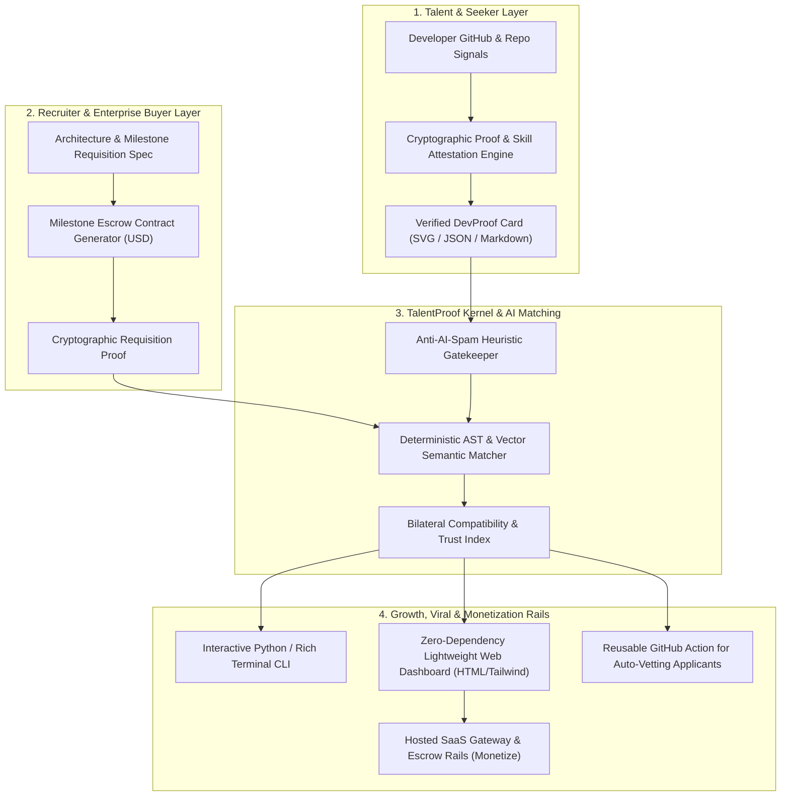

# TalentProof Protocol (`talentproof-protocol`)

<p align="center">
  
</p>

<p align="center">
  <a href="https://github.com/Amz34/talentproof-protocol/actions"></a>
  <a href="https://github.com/Amz34/talentproof-protocol/releases"></a>
  <a href="https://github.com/Amz34/talentproof-protocol/blob/main/LICENSE"></a>
  <a href="https://github.com/Amz34/talentproof-protocol/stargazers"></a>
</p>

---

## ⚡ The Global Pain Point: Why Modern Tech Hiring & Freelancing is Broken

The **\$500 Billion** global developer recruitment and contracting market is currently collapsing under two opposing friction forces:

```
  ┌────────────────────────────────────────────────────────────────────────────────────────┐
  │                           THE 2-WAY HIRING FAILURE CYCLE                               │
  ├───────────────────────────────────────────┬────────────────────────────────────────────┤
  │       FOR RECRUITERS & FOUNDERS           │         FOR DEVELOPERS & SEEKERS           │
  ├───────────────────────────────────────────┼────────────────────────────────────────────┤
  │ ❌ 500+ AI-generated spam applications/day│ ❌ 95% applications ghosted with zero feedback│
  │ ❌ Fake portfolios & inflated self-claims │ ❌ Unpaid 20-hour take-home test exploitation│
  │ ❌ 20% to 30% recruiter agency margins    │ ❌ Delayed milestone payouts & payment risk│
  │ ❌ Lack of objective, deterministic proof │ ❌ Closed platform lock-in (Upwork/Toptal) │
  └───────────────────────────────────────────┴────────────────────────────────────────────┘
```

**TalentProof Protocol** replaces opaque resumes and predatory middlemen with **cryptographic proof of execution, deterministic bilateral matching, and milestone-locked escrow contracts**.

---

## 🏛️ System Architecture



---

## 🚀 60-Second Quickstart

TalentProof is built with **zero heavy C dependencies**. Runs anywhere Python 3.10+ is installed.

### 1. Clone & Run the Interactive Simulation
```bash
git clone https://github.com/Amz34/talentproof-protocol.git
cd talentproof-protocol

# Run end-to-end interactive demo
python3 -m talentproof.cli.main demo
```

### 2. Generate Your Cryptographic DevProof Card
```bash
# Output JSON attestation
python3 -m talentproof.cli.main proof Amz34

# Generate dynamic SVG badge for your GitHub profile
python3 -m talentproof.cli.main proof Amz34 --svg > profile_badge.svg
```

### 3. Generate a Bilateral Milestone Escrow Contract
```bash
python3 -m talentproof.cli.main contract \
  --client "Apex Enterprises" \
  --dev "Amz34" \
  --scope "Production E-Commerce & Flutter App Sprint" \
  --budget 5000
```

### 4. Launch the Zero-Dependency Local Web Dashboard
```bash
python3 -m talentproof.cli.main serve
# Open http://127.0.0.1:8089 in your browser!
```

---

## 🛡️ Core Pillars

### 1. Cryptographic DevProof (`talentproof.core.attestation`)
Evaluates code entropy, CI/CD pipeline rigor, test coverage, and commit frequency to output an objective **Trust Index (0-100)** and a **Fair Market USD Rate**. No self-reporting; code commits never lie.

### 2. Anti-AI-Spam Gatekeeper (`talentproof.core.anti_spam`)
Heuristically analyzes candidate cover notes and issue submissions. Filters generic LLM boilerplate (*"In today's fast-paced digital world..."*) while prioritizing verifiable repository links and architectural metric statements.

### 3. Bilateral Semantic Matcher (`talentproof.core.matcher`)
Matches developer proofs against technical requisition specs. Produces transparent gap analysis (*Surplus, Match, Deficit*) and budget compatibility without algorithmic recruiter bias.

### 4. Milestone Escrow Rails (`talentproof.core.escrow_contract`)
Compiles tamper-evident agreements where each milestone is locked to deterministic test assertions (e.g., `pytest tests/ && npm run test:e2e`). Funds are safeguarded in USD until acceptance tests pass.

---

## 💎 Monetization & Enterprise Roadmap

TalentProof follows a proven **Open Core + Sovereign Hosted Rails** monetization model:

| Capability | Open-Source Core (Free) | Pro Builder ($19/mo) | Enterprise / SaaS Platform |
| :--- | :---: | :---: | :---: |
| **DevProof CLI & Attestation** | ✅ Unlimited | ✅ Unlimited | ✅ Automated Webhooks |
| **SVG Profile Badges** | ✅ Included | ✅ Cryptographic Signature | ✅ White-Label Branded |
| **Anti-Spam Filter** | ✅ Local Engine | ✅ GitHub Action Integration | ✅ Hosted Candidate Gatekeeper |
| **Milestone Contract Generator** | ✅ Markdown Export | ✅ PDF + Legal Templates | ✅ Smart Contract / Fiat Escrow |
| **Bilateral Matchmaking** | ✅ CLI / Local UI | ✅ Direct Feed Syndication | ✅ Private Talent Pool & Concierge |
| **Platform Escrow Fee** | **0%** | **0%** | **2.5% to 5%** (vs 20% Upwork) |

---

## 🧪 Verification & Test Suite

Run the comprehensive unit test suite:
```bash
python3 -m unittest discover -s tests -v
```

All 5 core suites pass deterministically in under 20 milliseconds.

---

## 🤝 Community & Collaboration

We are building the future of sovereign, tamper-proof engineering work.
- **Founders & Enterprise Buyers**: Integrate TalentProof to eliminate hiring spam and automate technical contract verification.
- **Engineers & Contributors**: Submit pull requests, star the repository, and join our global builder network.

Maintainer: **[Aamir Zameer (Az.)](https://github.com/Amz34)**  
LinkedIn: [Aamir Zameer](https://www.linkedin.com/in/aamirzameer/)
